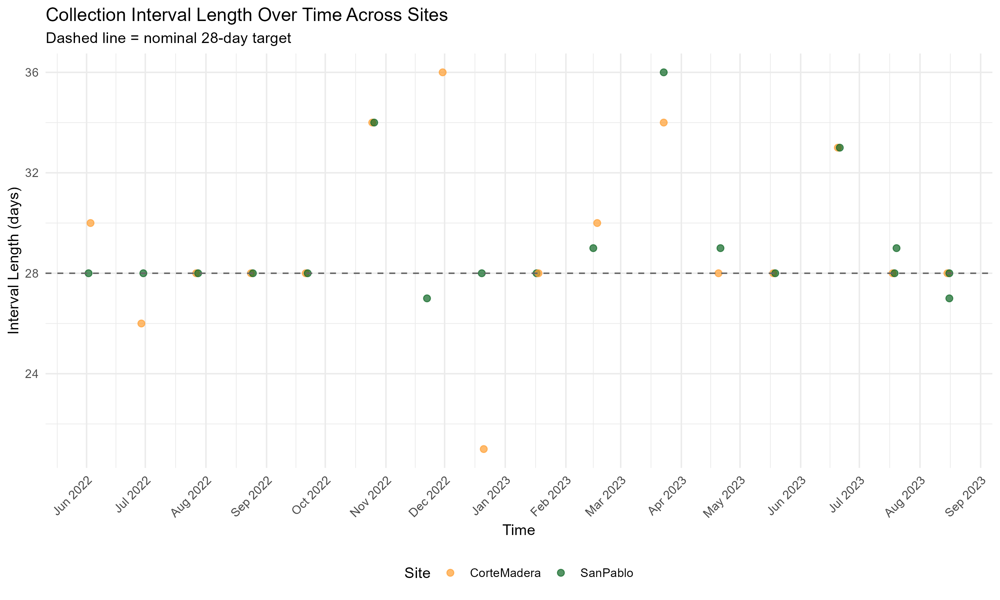
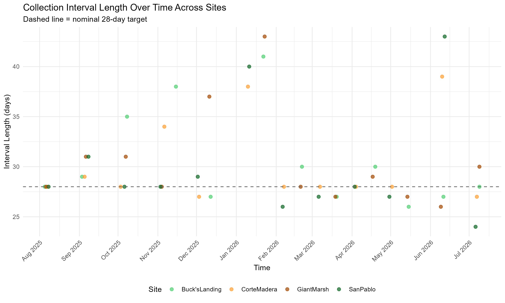

### 1. Introduction

### 2. Methods

#### 2.1 Study Sites

*Figure 1. Sediment Deposition Processes with Structural, Biotic, and Abiotic Factors (reproduced from Leondari 2018)*

*Figure 2. Scarp Marsh Edge Shape and Sediment Deposition Processes (reproduced from Fagherazzi 2020)*

*Figure 3. General Study Site*

*Figure 4. General Study Site with Elevation Survey Benchmarks Included*

#### 2.2 Marsh Edge Typology

#### 2.3 Sediment Deposition Collections throughout the Year

*Figure 3. Transect Layout of Study Design With Ramped and Scarped Edges*

{width="705"}

*Figure 4. Deployment Length within Study Period (2022-2023)* 

*Figure 5. Deployment Length within Study Period (2025-2026)* 

*Figure 6. Criteria Table for Qualitative and Quantative Quality Control Determinations* 

### 3. Results

#### 3.1 RTK Elevation Measurements for Horizontal Marsh Edge Profiles of 2025-2026 Study

*Figure 7. Elevation Profiles of Scarped Edges Sites-Giant Marsh and Corte Madera* 

*Figure 8. Elevation Profiles of Ramped Edges Sites-Buck's Landing and San Pablo* 

*Figure 9. Quality Control Results by Study Phase Collected*

*Figure 10. Quality Control Results by Distance from Marsh Edge*

*Figure 11. Quality Control Flag Frequency Per Distance Sampled*

*Figure 12. Total Percentages of Flags Occurred within Site*

#### 3.2 Sediment Deposition Across Ramped and Scarped Marsh Edges

*Figure 13. Sediment Flux Across Ramped and Scarped Marsh Edges in 2025/2026*

#### 3.3 Comparing 2022/2023 and 2025/2026 Flux Across Corte Madera Marsh

#### 3.4 Sediment Deposition in Relation to Intra-Marsh Geomorphic Factors

*Intra-Marsh Geomorphic Factor Comparison*

*Figure 22. Least Absolute Shrinkage and Selection Operator (LASSO) Regression Model of Intra-Marsh Geomorphic Variables*

*Elevation and Distance from Marsh Edge*

*Figure 23. Comparing Average Flux and Variability Across Distance from Marsh Edge and z star*

*Figure 24. Variance Across Time and Space Between and Across Sites of Sediment Deposition (Flux)*

*Figure 25. Sediment Deposition (Flux) Across z star profiles Across Marsh Sites*

*Figure 26. Sediment Deposition (Flux) Across Distance Over Study Collections Between Sites*

*Figure 27. Corte Madera Site Case Study of Sediment Deposition (Flux) Across Distance from Marsh Edge Across Study Collections Between 2022/2023 vs. 2025/2026*

### 5. Discussion

*Figure 28. Distribution of Values Between Ramped and Scarped Marsh Sites*

*Figure 29. LASSO Analysis Adjusted Per Site*

*Figure 30. Average Precipitation Between 2022/2023 and 2025/2026 from San Francisco Bay (will get exact tidal station information)*

*Figure 31. 2022/2023 and 2025/2026 Distribution Plot Comparisons Between Corte Madera Marsh and San Pablo Marsh*

*Figure 32. San Pablo 2022/2023 Unvegetated Marsh Sampling Points Incorporated Within Study*

